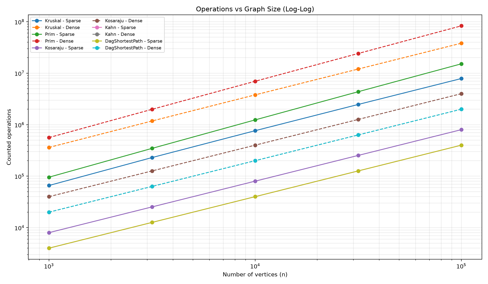
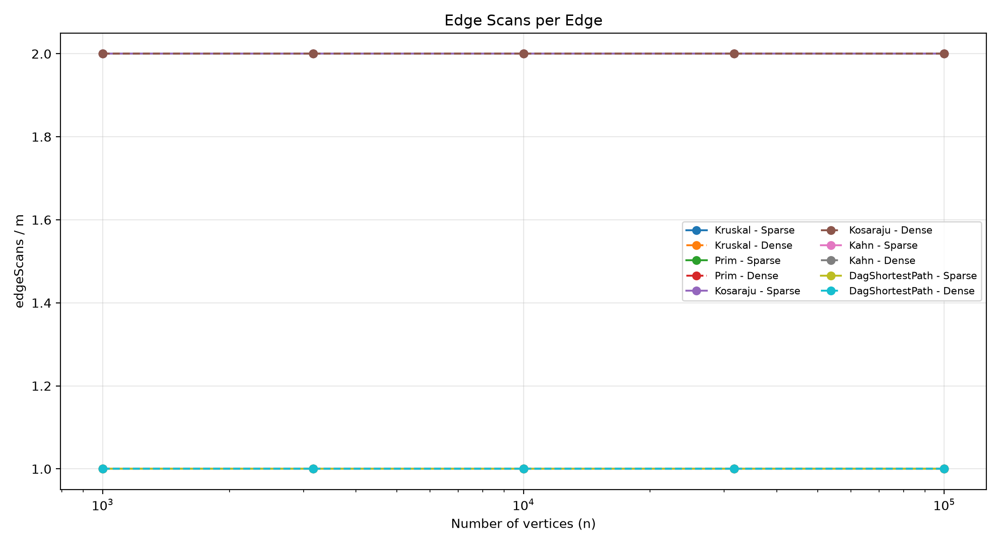
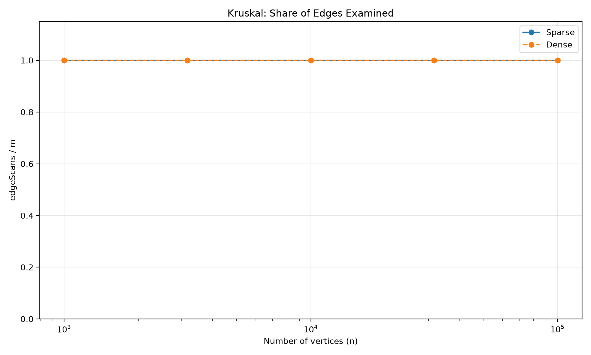

# DAA Assignment 3 — Graph Algorithms

**Student:** Aruzhan Marat | **Group:** SE-2525  
**Course:** Design and Analysis of Algorithms | **Tools:** Java 25, Maven, JUnit 5

## 1. Overview

The project implements DSU, Kruskal, Prim, Kosaraju, Kahn and DAG shortest paths, plus Tarjan SCC (+10%) and condensation/critical path (+5%). Weighted adjacency lists support directed and undirected graphs. JUnit tests check MST agreement, SCC against brute-force BFS, DAG distances against Bellman–Ford (including negative weights), and iterative DFS stack safety at 100,000 vertices.

Benchmarks use `Random(42)`, five sizes (1,000; 3,162; 10,000; 31,623; 100,000) and two densities (E = 4V and E = 20V). Five algorithms per configuration produce **50 CSV rows**. Timing is the median of five runs. All ten configurations reproduce reference MST weights, SCC counts and sums of DAG distances.

## 2. Complexity Table

| Algorithm | Time | Extra space | Justification |
|---|---|---|---|
| DSU find/union | Amortized O(α(V)) | O(V) DSU storage | Path compression and union by size |
| Kruskal | O(E log E) | O(V + E) | Edge sorting and DSU |
| Prim | O((V + E) log(V + E)) | O(V + E) | Candidate-edge priority queue |
| Kosaraju | O(V + E) | O(V + E) | Two iterative DFS passes and reverse graph |
| Kahn | O(V + E) | O(V) | In-degree array and queue |
| DAG shortest paths | O(V + E) | O(V) | Topological sort and one relaxation pass |
| Tarjan (bonus) | O(V + E) | O(V) | Iterative DFS, indices, lowlinks and stack |
| Critical path on DAG (bonus) | O(V + E) | O(V) | Maximum-weight topological relaxations |

Here α is the inverse Ackermann function. Extra space excludes input graph storage; DSU storage includes its parent and size arrays.

## 3. Operation Counters and Slopes

Measured counters are `dsuOps`, `edgeScans`, `comparisons`, and `maxDepth`. For plotting, **operations = dsuOps + edgeScans + comparisons**: a reproducible operation proxy, not an instruction count.

| Algorithm | Sparse operations slope | Dense operations slope | Edge-scan slope |
|---|---:|---:|---:|
| Kruskal | 1.037 | 1.012 | 1.000 |
| Prim | 1.101 | 1.085 | 1.000 |
| Kosaraju | 1.000 | 1.000 | 1.000 |
| Kahn | 1.000 | 1.000 | 1.000 |
| DAG shortest paths | 1.000 | 1.000 | 1.000 |

On log-log axes, traversal slopes of 1.000 support linear edge-scanning work at fixed density. Kruskal scans every edge once, so its **edge-scan** slope is 1.000; sorting comparisons explain why its total-operation slope is slightly higher.

For sparse graphs (E = 4V), Kruskal's `dsuOps/E` remains **4.8040–4.8250** across sizes. `edgeScans/(V+E)` stays **1.6000** for Prim and Kosaraju, and **0.8000** for Kahn and DAG shortest paths. This is expected: Prim scans 2E undirected adjacency entries, Kosaraju scans 2E in two passes, while Kahn and DAG relaxation scan E. Stable ratios empirically support their stated complexities.

## 4. Plots

**Operations vs V (log-log).** Traversals scale nearly linearly; sorting and priority-queue comparisons add work for MST algorithms.

**Edge scans per edge.** Flat ratios show 2 for Prim/Kosaraju and 1 for Kruskal/Kahn/DAG shortest paths.

**Kruskal examined-edge share.** Sparse and dense curves overlap at 1.0 because this implementation examines all E edges without early stopping.

## 5. Correctness Arguments

### MST — cut property

Consider a cut partitioning an undirected graph's vertices into two sets. A lightest edge across a cut is safe when the currently selected forest can be extended to an MST. If an MST omits that edge, adding it creates a cycle. Another edge on the cycle crosses the cut and is at least as heavy, so exchanging these edges does not increase the total weight. Kruskal considers edges from lightest to heaviest and uses DSU to join different components without cycles. Prim chooses the lightest crossing edge between visited and unvisited vertices. Both therefore construct minimum spanning trees, or minimum spanning forests for disconnected graphs.

### DAG shortest paths — induction on topological order

In a DAG, every edge points forward in a topological ordering. Each vertex with in-degree zero starts at distance zero, representing a virtual super-source. Those source distances are initially correct. Assume all previously processed vertices have correct shortest distances. Every predecessor of the current vertex has already been processed, so all incoming relaxations have been considered. Hence its distance is minimal, and relaxing its outgoing edges propagates correct candidates to later vertices. By induction, a single topological pass finds all shortest distances. Negative weights are safe because DAGs contain no directed cycles, including negative cycles.

## 6. Which Algorithm When?

| Situation | Preferred algorithm | Reason |
|---|---|---|
| MST using edge list | Kruskal | Sorting edges and DSU; convenient on sparse graphs |
| MST using adjacency lists | Prim | Grows a tree with a priority queue |
| Disconnected undirected graph | Kruskal or Prim | Returns a minimum spanning forest |
| Identify strongly connected jobs | Kosaraju or Tarjan | SCCs expose cycles; Tarjan uses one DFS pass |
| Order dependencies / detect directed cycles | Kahn | Queue by in-degree; incomplete order indicates a cycle |
| DAG shortest paths with negative weights | DAG shortest paths | Linear topological relaxation |
| Scheduling longest dependency chain | Condensation + critical path | Condensed SCC graph is a DAG |

**Bonus comparison:** Tarjan records E edge scans compared with Kosaraju's 2E DFS scans. Condensation contracts each SCC to one vertex and retains weighted inter-component edges. The resulting DAG permits linear-time longest-path relaxation, unlike the difficult longest-simple-path problem in general graphs.

## 7. Timing and Conclusion

At V = 100,000 and E = 2,000,000, median times were **988.276 ms** (Kruskal), **1,999.716 ms** (Prim), **709.894 ms** (Kosaraju), **132.672 ms** (Kahn), and **258.455 ms** (DAG shortest paths). Timing depends on JVM compilation, hardware and background load; reproducible counters are stronger complexity evidence. Matching reference values, independent JUnit tests and stable counter ratios support correctness and expected algorithm behavior.
